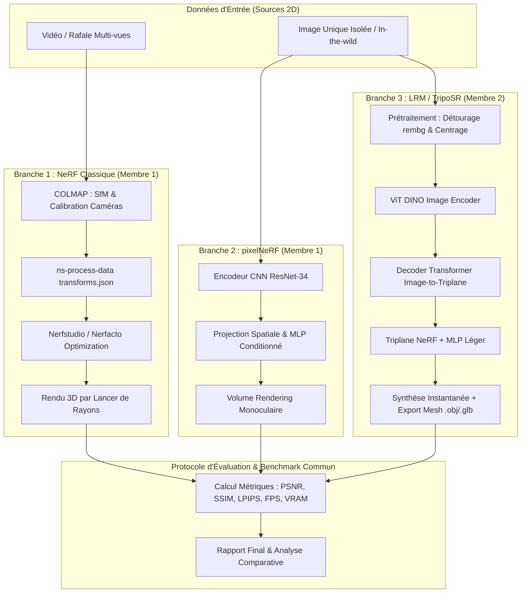

# De la 2D à la 3D : Étude Comparative et Évolution des Champs de Radiance Neuronaux (NeRF, pixelNeRF & LRM)

[](https://www.python.org/)
[](https://pytorch.org/)
[](https://developer.nvidia.com/cuda-toolkit)
[](https://docs.nerf.studio/)
[](https://huggingface.co/)

> **Projet de Master M2I — Semestre 3 — Module Traitement d'Images & Vision par Ordinateur**  
> **Binôme :** Membre 1 (NeRF & pixelNeRF) & Membre 2 (LRM / TripoSR)  
> **Encadrement :** Architecture MLOps & Vision par Ordinateur

---

## 1. Objectifs & Problématique Scientifique

Le passage d'une ou plusieurs projections 2D (images RGB) à une représentation 3D exploitable constitue un **problème inverse mal posé** (*ill-posed inverse problem*), car l'information de profondeur ($Z$) est projetée et perdue lors de l'acquisition par le capteur photographique.

L'objectif de ce projet est de retracer, d'implémenter et d'évaluer expérimentalement la transition technologique majeure intervenue entre 2020 et 2024 dans le domaine de la **synthèse de nouvelles vues (*Novel View Synthesis - NVS*)** et de la **génération 3D monoculaire** :

1. **NeRF (Mildenhall et al., ECCV 2020) :** Représentation continue implicite optimisée par descente de gradient sur une scène unique à partir d'un ensemble dense d'images multi-vues calibrées.
2. **pixelNeRF (Yu et al., CVPR 2021) :** Première rupture vers la généralisation monoculaire via le conditionnement spatialisé d'un champ de radiance par un encodeur convolutif (CNN).
3. **LRM / Large Reconstruction Model (Hong et al., 2023) :** Changement de paradigme avec l'avènement des modèles fondation ; passage à une architecture Transformer (Vision Transformer / DINO) prédisant des représentations 3D explicites structurées (*Triplane NeRF*) en moins d'une seconde à partir d'une seule image non calibrée (*in-the-wild*).

---

## 2. Pipeline Global du Projet

Le workflow expérimental et comparatif s'articule autour de trois branches d'expérimentation convergeant vers un protocole d'évaluation unifié :



---

## 3. Technologies & Outils Utilisés

| Domaine | Outils & Bibliothèques | Utilisation Principale |
| :--- | :--- | :--- |
| **Langage & Core IA** | `Python 3.10+`, `PyTorch >= 2.0`, `CUDA Toolkit (11.8 / 12.1)` | Base de calcul tensoriel et gestion GPU |
| **Calibration Géométrique** | `COLMAP` | *Structure-from-Motion* (SfM), estimation des poses $(R, t)$ et focales |
| **Framework NeRF** | `Nerfstudio`, `instant-ngp` | Entraînement accéléré, visualisation interactive WebGL en temps réel |
| **Modélisation Générale** | `pixel-nerf` (PyTorch repo officiel) | Extraction de features multi-échelles et conditionnement de rayon |
| **State-of-the-Art 3D** | `OpenLRM`, `TripoSR`, `Hugging Face Transformers`, `xformers` | Inférence Transformer ViT $\rightarrow$ Triplane haute vitesse |
| **Traitement d'Image & 3D** | `OpenCV`, `Pillow`, `rembg`, `Open3D`, `Trimesh` | Prétraitement, segmentation d'arrière-plan, manipulation de maillages |
| **Évaluation & Visualisation** | `torchmetrics`, `lpips`, `Plotly`, `MeshLab` | Métriques quantitatives (PSNR, SSIM, LPIPS) et inspection 3D |

---

## 4. Organisation du Répertoire & Arborescence

Le projet est structuré par domaines fonctionnels pour séparer rigoureusement les articles théoriques, la gestion de projet, les feuilles de route, le protocole d'évaluation, le code source de chaque membre et les résultats :

```text
PROJET/
├── README.md                                           # Documentation principale et synthèse du projet
│
├── articles/                                           # Fiches d'analyse et articles scientifiques
│   ├── article_1_nerf_mildenhall_et_al_2020.md         # Fiche de synthèse NeRF
│   ├── article_2_pixelnerf_yu_et_al_2021.md            # Fiche de synthèse pixelNeRF
│   ├── article_3_lrm_hong_et_al_2023.md                # Fiche de synthèse LRM
│   ├── Article_NeRF.pdf                                # Papier de recherche NeRF
│   ├── Article_LRM.pdf                                 # Papier de recherche LRM
│   ├── prompt_ma_tre_du_projet_2d_vers_3d.md           # Prompt maître & cadrage théorique des articles
│   └── urls_des_articles.md                            # Liens ArXiv, GitHub & démos
│
├── feuilles_de_route/                                  # Feuilles de route opérationnelles individuelles
│   ├── feuille_de_route_membre_1_nerf_pixelnerf.md     # Feuille de route Membre 1 (Toi)
│   └── feuille_de_route_membre_2_lrm.md                # Feuille de route Membre 2 (Binôme)
│
├── gestion_projet/                                     # Pilotage, suivi de cycle de vie et évaluation
│   ├── cycle_de_vie_et_suivi_projet.md                 # Dashboard vivant & checklist d'avancement
│   └── evaluation/                                     # Protocole de test et métriques
│       └── protocole_d_valuation_et_benchmark_comparatif.md # Protocole PSNR/SSIM/LPIPS & plan rapport
│
├── data/                                               # Datasets et jeux de données (à créer à la Phase 0)
│   ├── raw/                                            # Données brutes (vidéos .mp4, photos non traitées)
│   ├── processed/                                      # Données calibrées (après COLMAP / rembg)
│   │   ├── colmap_scenes/                              # Sorties transforms.json pour Nerfstudio
│   │   └── masked_single_images/                       # Images détourées au format RGB-Alpha pour LRM
│   └── benchmark_samples/                              # 3 à 5 scènes/objets communs de référence pour le test
│
├── models/                                             # Poids et checkpoints pré-entraînés
│   ├── nerf_checkpoints/                               # Modèles sauvegardés Nerfstudio
│   ├── pixelnerf_checkpoints/                          # Checkpoints officiels ShapeNet (Chairs/Cars)
│   └── lrm_checkpoints/                                # Poids OpenLRM / TripoSR téléchargés
│
├── src/                                                # Code source exécutable
│   ├── common/                                         # Utilitaires partagés
│   │   ├── metrics.py                                  # Scripts de calcul automatique PSNR / SSIM / LPIPS
│   │   ├── io_transforms.py                            # Conversion de poses de caméras et de formats
│   │   └── visualizer.py                               # Export de grilles comparatives et vidéos
│   │
│   ├── member1_nerf_pixelnerf/                         # Espace de travail : Membre 1
│   │   ├── scripts/
│   │   │   ├── run_colmap.bat / .sh                    # Automatisation extraction des poses
│   │   │   ├── train_nerf.py                           # Script de lancement Nerfstudio (Nerfacto)
│   │   │   └── infer_pixelnerf.py                      # Inférence monoculaire pixelNeRF
│   │   └── configs/                                    # Fichiers de configuration et hyperparamètres
│   │
│   └── member2_lrm/                                    # Espace de travail : Membre 2
│       ├── scripts/
│       │   ├── preprocess_image.py                     # Suppression automatique d'arrière-plan (rembg)
│       │   ├── run_lrm_inference.py                    # Pipeline d'inférence image-to-3D
│       │   └── export_mesh.py                          # Extraction de maillage (.obj / .glb)
│       └── configs/                                    # Paramètres d'inférence Triplane/Transformer
│
├── outputs/                                            # Résultats des inférences et rendus
│   ├── nerf_renders/                                   # Vues synthétisées et vidéos 360° NeRF
│   ├── pixelnerf_renders/                              # Rendus générés par pixelNeRF
│   ├── lrm_renders/                                    # Rendus et maillages générés par LRM
│   └── benchmark_results/                              # Tableaux de métriques générés et graphiques comparatifs
│
├── reports/                                            # Livrables académiques
│   ├── figures/                                        # Captures d'écran et graphiques pour le rapport
│   └── Rapport_Projet_2D_to_3D.pdf                     # Rapport final du mini-projet
│
├── requirements.txt                                    # Dépendances Python globales
└── environment.yml                                     # Définition de l'environnement Conda
│
├── requirements.txt                            # Dépendances Python globales
└── environment.yml                             # Définition de l'environnement Conda
```

---

## 5. Synthèse Théorique & Comparaison des Approches

```
                      ÉVOLUTION DE LA RECONSTRUCTION 3D (2020 - 2024)
                      
   [ NeRF (2020) ] ──────────────► [ pixelNeRF (2021) ] ──────────────► [ LRM / TripoSR (2023) ]
   
   • Entrée : Multi-vues (30-100+)  • Entrée : 1 seule image (Few-shot) • Entrée : 1 seule image (In-the-wild)
   • Cible : 1 scène statique       • Cible : Généralisation objet     • Cible : Modèle fondation universel
   • Archi : MLP pur + PE           • Archi : CNN (ResNet) + MLP        • Archi : Transformer (ViT DINO) + Triplane
   • Inférence : Optimisation lente • Inférence : Feed-forward rapide   • Inférence : Quasi-instantanée (< 1s)
   • Sortie : Champ implicite       • Sortie : Champ conditionné        • Sortie : Triplane NeRF + Maillage explicite
```

### Matrice Comparatrice

| Caractéristique | NeRF (Mildenhall et al., 2020) | pixelNeRF (Yu et al., 2021) | LRM (Hong et al., 2023) |
| :--- | :--- | :--- | :--- |
| **Type d'Entrée** | 30 à 100+ images multi-vues | 1 image (ou 2-3 vues éparses) | **1 seule image quelconque** |
| **Calibration Caméra requise** | **Obligatoire (COLMAP)** | Obligatoire lors de l'inférence | **Non requise (Prior implicite)** |
| **Temps d'adaptation / Objet** | 15 min à plusieurs heures | **0 s (Généralisation directe)** | **0 s (Généralisation directe)** |
| **Temps de génération 3D** | Long (par lancer de rayon) | Moyen (~quelques secondes) | **Ultra-rapide (< 1 seconde)** |
| **Qualité des détails** | Photoréaliste (haute fréquence) | Moyenne (flou hors catégories) | Très élevée (texture + géométrie) |
| **Cohérence des faces cachées** | Parfaite (scène observée) | Limitée (hallucination faible) | Excellente (prior appris sur 1M+ 3D) |

---

## 6. Répartition Opérationnelle des Rôles

### Membre 1 : Socle Fondamental & Modélisation Conditionnée
* **Missions :**
  1. Mise en place du pipeline NeRF via Nerfstudio (Nerfacto / Instant-NGP).
  2. Acquisition de scènes réelles et calcul des trajectoires caméras via COLMAP.
  3. Déploiement et évaluation de pixelNeRF avec poids pré-entraînés ShapeNet.
  4. Génération des rendus synthétisés sur le jeu de test commun.
* **Feuille de route détaillée :** [`feuilles_de_route/feuille_de_route_membre_1_nerf_pixelnerf.md`](file:///c:/Users/DELL/Documents/Master/Master_M2I/SEMESTRE%203/Module%202%20-%20Traitement%20d'images/Projet/feuilles_de_route/feuille_de_route_membre_1_nerf_pixelnerf.md)

### Membre 2 : Modèles Fondation 3D & State-of-the-Art
* **Missions :**
  1. Implémentation du pipeline LRM moderne via OpenLRM / TripoSR.
  2. Mise en place du pré-traitement automatisé (détourage d'arrière-plan via `rembg`, centrage et normalisation).
  3. Inférence instantanée *in-the-wild* et extraction de maillages surfaciques (`.obj`, `.glb`).
  4. Analyse architecturale du couplage Transformer DINO $\rightarrow$ Triplane.
* **Feuille de route détaillée :** [`feuilles_de_route/feuille_de_route_membre_2_lrm.md`](file:///c:/Users/DELL/Documents/Master/Master_M2I/SEMESTRE%203/Module%202%20-%20Traitement%20d'images/Projet/feuilles_de_route/feuille_de_route_membre_2_lrm.md)

### Tâches Communes
* Définition des 3 à 5 objets/scènes de test étalons.
* Exécution du script de benchmark automatisé (`src/common/metrics.py`) : PSNR, SSIM, LPIPS.
* Rédaction conjointe du rapport d'ingénierie et préparation de la soutenance.

---

## 7. Guide de Démarrage Rapide

### 1. Cloner le projet et préparer l'environnement
```bash
# Cloner le dépôt
git clone <url-du-depot-etudiant>
cd PROJET

# Créer l'environnement Conda recommandé
conda create -n vision3d python=3.10 -y
conda activate vision3d

# Installer PyTorch avec support CUDA (adapter selon votre version CUDA)
pip install torch torchvision --index-url https://download.pytorch.org/whl/cu118

# Installer les dépendances communes
pip install -r requirements.txt
```

### 2. Branche NeRF (Membre 1)
```bash
# Traitement des données vidéo avec COLMAP
ns-process-data video --data data/raw/mon_objet.mp4 --output-dir data/processed/colmap_scenes/mon_objet

# Entraînement Nerfacto
ns-train nerfacto --data data/processed/colmap_scenes/mon_objet
```

### 3. Branche LRM / TripoSR (Membre 2)
```bash
# Prétraitement et génération 3D instantanée
python src/member2_lrm/scripts/preprocess_image.py --input data/raw/mon_image.jpg --output data/processed/masked_single_images/mon_image.png
python src/member2_lrm/scripts/run_lrm_inference.py --image data/processed/masked_single_images/mon_image.png --output-dir outputs/lrm_renders/
```

### 4. Calcul du Benchmark Commun
```bash
python src/common/metrics.py --ground_truth data/benchmark_samples/gt/ --predictions outputs/
```

---

## 8. Références Bibliographiques

1. **NeRF :** Mildenhall, B., Srinivasan, P. P., Tancik, M., Barron, J. T., Ramamoorthi, R., & Ng, R. (2020). *NeRF: Representing Scenes as Neural Radiance Fields for View Synthesis*. ECCV 2020.
2. **pixelNeRF :** Yu, A., Ye, V., Tancik, M., & Kanazawa, A. (2021). *pixelNeRF: Neural Radiance Fields from One or Few Images*. CVPR 2021.
3. **LRM :** Hong, Y., Liang, H., Yang, B., et al. (2023). *LRM: Large Reconstruction Model for Single Image to 3D*. arXiv:2311.04400.
4. **Instant-NGP :** Müller, T., Evans, A., Schied, C., & Keller, A. (2022). *Instant Neural Graphics Primitives with a Multiresolution Hash Encoding*. ACM Transactions on Graphics (TOG).
5. **TripoSR :** Tochilkin, D., Pankratz, D., Gao, Z., et al. (2024). *TripoSR: Fast 3D Object Reconstruction from a Single Image*. Stability AI & VAST AI.
