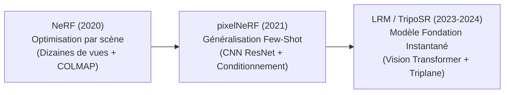

# Tableau de Bord & Suivi d'Avancement du Projet (Master M2I - Vision & 3D)

> **Projet :** De la 2D à la 3D : Étude Comparative et Évolution des Champs de Radiance Neuronaux (NeRF, pixelNeRF & LRM)  
> **Binôme :** 
> - **Toi (Membre 1) :** NeRF classique & pixelNeRF
> - **Samir (Membre 2) :** LRM (Large Reconstruction Model) / TripoSR
> **Date de mise à jour :** 23 Novembre 2026

---

## 1. Vue d'Ensemble & Synthèse Théorique des 3 Modèles

Ce projet retrace le saut de paradigme scientifique majeur de la vision par ordinateur entre 2020 et 2024 :

| Critère | 1. NeRF (Mildenhall 2020) | 2. pixelNeRF (Yu 2021) | 3. LRM / TripoSR (Hong 2023) |
| :--- | :--- | :--- | :--- |
| **Type d'apprentissage** | Optimisation par scène (*Per-scene optimization*) | Entraîné sur dataset multi-scènes (ShapeNet) | Modèle fondation pré-entraîné à grande échelle |
| **Entrées requises** | ~50 à 100 images denses + Poses de caméra ($R, t$) | 1 à 3 images + calibration | **1 seule image non calibrée (*in-the-wild*)** |
| **Temps de reconstruction** | 15 à 45 minutes d'entraînement par scène | Quelques secondes à minutes | **< 1 seconde (Inférence directe)** |
| **Architecture clé** | MLP profond (Positional Encoding) | ResNet-34 (CNN) + MLP conditionné | ViT DINO + Transformer Image-to-Triplane |
| **Représentation 3D** | Champ implicite continu $(\mathbf{x}, \mathbf{d}) \rightarrow (\mathbf{c}, \sigma)$ | Volume implicite aligné aux pixels | Triplane NeRF explicite/implicite + Mesh (.obj/.glb) |

---

## 2. Suivi Détaillé : Toi (Membre 1 - NeRF & pixelNeRF)

### 2.1. Tâche 1 : NeRF Classique (Nerfacto - Entraînement From Scratch)
- **Objectif :** Entraîner le modèle de zéro (*from scratch*) sur la scène Lego pour illustrer le principe d'optimisation continue par scène (Mildenhall 2020).
- **Fichiers associés :**
  - **Notebook officiel NeRF (30k itérations) :** [`notebooks/01_nerf_lego_30k_complete.ipynb`](file:///c:/Users/DELL/Documents/Master/Master_M2I/SEMESTRE%203/Module%202%20-%20Traitement%20d'images/Projet/notebooks/01_nerf_lego_30k_complete.ipynb)
  - Anciens tests archivés : `notebooks/archive/` (`01_env_check_nerf.ipynb`, `02_check_status_nerf.ipynb`)
  - Rendus obtenus (classés dans [`results_renders/`](file:///c:/Users/DELL/Documents/Master/Master_M2I/SEMESTRE%203/Module%202%20-%20Traitement%20d'images/Projet/results_renders)) :
    - `lego_5000_spiral.mp4` / `lego_5000_spiral_hd.mp4` (5 000 itérations - ébauche géométrique)
    - En cours / Cible : `lego_30000_spiral_cristal.mp4` (30 000 itérations - haute fidélité cristalline)
- **Méthode retenue :** **Entraînement complet From Scratch (30 000 itérations)**.
- **Statut :** **En cours d'entraînement (session Colab)**.

### 2.2. Tâche 2 : pixelNeRF (Inférence avec Poids Pré-entraînés)
- **Objectif :** Démontrer la généralisation sans ré-optimisation à partir d'une seule image 2D grâce au conditionnement spatial (Yu 2021).
- **Méthode retenue :** **Inférence directe avec les poids officiels pré-entraînés** (ShapeNet / DTU). L'entraînement *from scratch* nécessitant des jours de calculs sur multi-GPU et des centaines de Go de données, l'inférence sur poids pré-entraînés est la démarche académique standard recommandée.
- **Fichiers associés :**
  - **Notebook officiel pixelNeRF (1-vue) :** [`notebooks/02_pixelnerf_inference.ipynb`](file:///c:/Users/DELL/Documents/Master/Master_M2I/SEMESTRE%203/Module%202%20-%20Traitement%20d'images/Projet/notebooks/02_pixelnerf_inference.ipynb)
  - Guide technique complet : [`docs/roadmaps/pixelnerf_guide_et_suivi.md`](file:///c:/Users/DELL/Documents/Master/Master_M2I/SEMESTRE%203/Module%202%20-%20Traitement%20d'images/Projet/docs/roadmaps/pixelnerf_guide_et_suivi.md)
  - Code source officiel de référence : [`repos_reference/pixel-nerf-master`](file:///c:/Users/DELL/Documents/Master/Master_M2I/SEMESTRE%203/Module%202%20-%20Traitement%20d'images/Projet/repos_reference/pixel-nerf-master)
  - Poids officiels pré-entraînés (Google Drive des auteurs) : `srn_chair`, `srn_car`, `sn64`.
- **Statut :** **Notebook et guide créés, prêt à être exécuté dès la fin de NeRF ✅**

---

## 3. Suivi Détaillé : Samir (Membre 2 - LRM / TripoSR)

### 3.1. Tâche : LRM / TripoSR (Large Reconstruction Model)
- **Objectif :** Démontrer l'état de l'art actuel de la reconstruction monoculaire instantanée par Transformer.
- **Fichiers associés :**
  - Fiche de synthèse théorique : [`articles/article_3_lrm_hong_et_al_2023.md`](file:///c:/Users/DELL/Documents/Master/Master_M2I/SEMESTRE%203/Module%202%20-%20Traitement%20d'images/Projet/articles/article_3_lrm_hong_et_al_2023.md)
  - Papier de recherche : [`articles/Article_LRM.pdf`](file:///c:/Users/DELL/Documents/Master/Master_M2I/SEMESTRE%203/Module%202%20-%20Traitement%20d'images/Projet/articles/Article_LRM.pdf)
  - Feuille de route Samir : [`feuilles_de_route/feuille_de_route_membre_2_lrm.md`](file:///c:/Users/DELL/Documents/Master/Master_M2I/SEMESTRE%203/Module%202%20-%20Traitement%20d'images/Projet/feuilles_de_route/feuille_de_route_membre_2_lrm.md)
  - Code & scripts de Samir : dossier `src/` (branche membre 2)
- **Statut :** **À DÉMARRER ⏳**
- **Étapes clés pour Samir :**
  1. Configurer un notebook Google Colab (GPU T4) avec **TripoSR** (`VAST-AI-Research/TripoSR`) ou **OpenLRM**.
  2. Implémenter le pipeline de prétraitement automatique avec `rembg` (détourage du fond obligatoire).
  3. Effectuer l'inférence sur les **mêmes images de test** que toi pour le benchmark comparatif.
  4. Exporter les vidéos de rendu et les maillages 3D (`.obj` ou `.glb`).
  5. Mesurer le temps d'inférence (généralement < 1 s) et la consommation VRAM.

---

## 4. Protocole de Benchmark Commun (Convergence des Travaux)

Pour comparer équitablement les 3 approches dans le rapport de Master :

| Métrique / Critère | NeRF (Toi) | pixelNeRF (Toi) | LRM / TripoSR (Samir) |
| :--- | :--- | :--- | :--- |
| **Nombre d'images d'entrée** | ~100 vues (Dense) | 1 à 3 vues (Sparse) | **1 vue (Monoculaire)** |
| **Temps de calcul total** | ~10-20 min (entraînement) | Secondes (inférence) | **~0.6 s (inférence)** |
| **Qualité visuelle (PSNR / SSIM)** | Très élevée sur la scène apprise | Modérée (généralisation) | Élevée avec géométrie complète |
| **Représentation finale** | Densité volumique (NeRF) | Densité volumique (NeRF) | **NeRF Triplane + Mesh 3D (.obj)** |

---

## 5. Journal des Mises à Jour & Historique

- **16-17 Nov 2026 :** Validation de l'environnement Colab GPU T4. Entraînement NeRF (Nerfacto) sur Lego à 5 000 itérations. Export de `lego_5000_spiral.mp4` et `lego_5000_spiral_hd.mp4`.
- **23-24 Nov 2026 :** Création du notebook NeRF 30k complet (`01_nerf_lego_30k_complete.ipynb`), résolution des quotas GPU et correction de sécurité PyTorch (`TORCH_FORCE_NO_WEIGHTS_ONLY_LOAD=1`).
- **25 Nov 2026 :** 
  - Restructuration propre du projet en architecture standard MLOps (`notebooks/`, `docs/`, `repos_reference/`, `results_renders/`).
  - **Lancement officiel de la branche pixelNeRF** : création du guide théorique [`docs/roadmaps/pixelnerf_guide_et_suivi.md`](file:///c:/Users/DELL/Documents/Master/Master_M2I/SEMESTRE%203/Module%202%20-%20Traitement%20d'images/Projet/docs/roadmaps/pixelnerf_guide_et_suivi.md) et du notebook d'inférence monoculaire [`notebooks/02_pixelnerf_inference.ipynb`](file:///c:/Users/DELL/Documents/Master/Master_M2I/SEMESTRE%203/Module%202%20-%20Traitement%20d'images/Projet/notebooks/02_pixelnerf_inference.ipynb).
