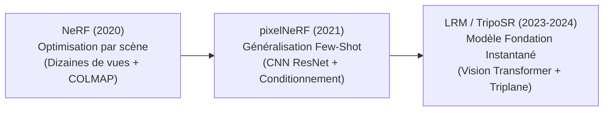

# Tableau de Bord & Suivi d'Avancement du Projet (Master M2I - Vision & 3D)

> **Projet :** De la 2D à la 3D : Étude Comparative et Évolution des Champs de Radiance Neuronaux (NeRF, pixelNeRF & LRM)  
> **Binôme :** 
> - **Toi (Membre 1) :** NeRF classique & pixelNeRF
> - **Samir (Membre 2) :** LRM (Large Reconstruction Model) / TripoSR
> **Date de mise à jour :** 23 Novembre 2026

---

## 1. Vue d'Ensemble & Synthèse Théorique des 3 Modèles

Ce projet retrace le saut de paradigme scientifique majeur de la vision par ordinateur entre 2020 et 2024 :

| Critère | 1. NeRF (Mildenhall 2020) | 2. pixelNeRF (Yu 2021) | 3. LRM / TripoSR (Hong 2023) |
| :--- | :--- | :--- | :--- |
| **Type d'apprentissage** | Optimisation par scène (*Per-scene optimization*) | Entraîné sur dataset multi-scènes (ShapeNet) | Modèle fondation pré-entraîné à grande échelle |
| **Entrées requises** | ~50 à 100 images denses + Poses de caméra ($R, t$) | 1 à 3 images + calibration | **1 seule image non calibrée (*in-the-wild*)** |
| **Temps de reconstruction** | 15 à 45 minutes d'entraînement par scène | Quelques secondes à minutes | **< 1 seconde (Inférence directe)** |
| **Architecture clé** | MLP profond (Positional Encoding) | ResNet-34 (CNN) + MLP conditionné | ViT DINO + Transformer Image-to-Triplane |
| **Représentation 3D** | Champ implicite continu $(\mathbf{x}, \mathbf{d}) \rightarrow (\mathbf{c}, \sigma)$ | Volume implicite aligné aux pixels | Triplane NeRF explicite/implicite + Mesh (.obj/.glb) |

---

## 2. Suivi Détaillé : Toi (Membre 1 - NeRF & pixelNeRF)

### 2.1. Tâche 1 : NeRF Classique (Nerfstudio / Nerfacto)
- **Objectif :** Maîtriser le pipeline complet : poses de caméras, volume rendering, optimisation par descente de gradient, convergence et rendu.
- **Fichiers associés :**
  - Notebook d'environnement : [`01_env_check_nerf.ipynb`](file:///c:/Users/DELL/Documents/Master/Master_M2I/SEMESTRE%203/Module%202%20-%20Traitement%20d'images/Projet/01_env_check_nerf.ipynb)
  - Notebook d'entraînement & check : [`02_check_status_nerf.ipynb`](file:///c:/Users/DELL/Documents/Master/Master_M2I/SEMESTRE%203/Module%202%20-%20Traitement%20d'images/Projet/02_check_status_nerf.ipynb)
  - Rendus obtenus :
    - `lego_spiral_preview.mp4` (première vérification)
    - `lego_5000_spiral.mp4` (rendu standard à 5 000 itérations)
    - `lego_5000_spiral_hd.mp4` (rendu haute résolution à 5 000 itérations)
  - Checkpoint sauvegardé sur Drive : `/MyDrive/nerf_lego_5000/`
- **Statut :** **Phase 5 000 itérations terminée ✅**
- **Action suivante :** 
  - Exécuter la mesure quantitative avec Nerfstudio : `ns-eval --load-config <config.yml>` pour noter le PSNR / SSIM / LPIPS à 5k itérations.
  - Optionnel pour le rapport final : reprise d'entraînement jusqu'à 20 000 itérations pour illustrer la transition de netteté (avant/après).

### 2.2. Tâche 2 : pixelNeRF
- **Objectif :** Réaliser une synthèse de nouvelles vues à partir de 1 à 3 images sans devoir ré-entraîner un modèle complet pendant des heures.
- **Fichiers associés :**
  - Fiche de synthèse théorique : [`articles/article_2_pixelnerf_yu_et_al_2021.md`](file:///c:/Users/DELL/Documents/Master/Master_M2I/SEMESTRE%203/Module%202%20-%20Traitement%20d'images/Projet/articles/article_2_pixelnerf_yu_et_al_2021.md)
  - Feuille de route : [`feuilles_de_route/feuille_de_route_membre_1_nerf_pixelnerf.md`](file:///c:/Users/DELL/Documents/Master/Master_M2I/SEMESTRE%203/Module%202%20-%20Traitement%20d'images/Projet/feuilles_de_route/feuille_de_route_membre_1_nerf_pixelnerf.md)
  - Code & scripts à implémenter : `src/member1_nerf_pixelnerf/`
- **Statut :** **À DÉMARRER ⏳**
- **Étapes clés :**
  1. Cloner le repo officiel ou l'implémentation PyTorch (`pixel-nerf`).
  2. Charger les poids pré-entraînés ShapeNet (*Chairs* ou *Cars*).
  3. Lancer l'inférence sur 1 image de test et générer la vidéo de rotation.
  4. Extraire les métriques de reconstruction.

---

## 3. Suivi Détaillé : Samir (Membre 2 - LRM / TripoSR)

### 3.1. Tâche : LRM / TripoSR (Large Reconstruction Model)
- **Objectif :** Démontrer l'état de l'art actuel de la reconstruction monoculaire instantanée par Transformer.
- **Fichiers associés :**
  - Fiche de synthèse théorique : [`articles/article_3_lrm_hong_et_al_2023.md`](file:///c:/Users/DELL/Documents/Master/Master_M2I/SEMESTRE%203/Module%202%20-%20Traitement%20d'images/Projet/articles/article_3_lrm_hong_et_al_2023.md)
  - Papier de recherche : [`articles/Article_LRM.pdf`](file:///c:/Users/DELL/Documents/Master/Master_M2I/SEMESTRE%203/Module%202%20-%20Traitement%20d'images/Projet/articles/Article_LRM.pdf)
  - Feuille de route Samir : [`feuilles_de_route/feuille_de_route_membre_2_lrm.md`](file:///c:/Users/DELL/Documents/Master/Master_M2I/SEMESTRE%203/Module%202%20-%20Traitement%20d'images/Projet/feuilles_de_route/feuille_de_route_membre_2_lrm.md)
  - Code & scripts de Samir : dossier `src/` (branche membre 2)
- **Statut :** **À DÉMARRER ⏳**
- **Étapes clés pour Samir :**
  1. Configurer un notebook Google Colab (GPU T4) avec **TripoSR** (`VAST-AI-Research/TripoSR`) ou **OpenLRM**.
  2. Implémenter le pipeline de prétraitement automatique avec `rembg` (détourage du fond obligatoire).
  3. Effectuer l'inférence sur les **mêmes images de test** que toi pour le benchmark comparatif.
  4. Exporter les vidéos de rendu et les maillages 3D (`.obj` ou `.glb`).
  5. Mesurer le temps d'inférence (généralement < 1 s) et la consommation VRAM.

---

## 4. Protocole de Benchmark Commun (Convergence des Travaux)

Pour comparer équitablement les 3 approches dans le rapport de Master :

| Métrique / Critère | NeRF (Toi) | pixelNeRF (Toi) | LRM / TripoSR (Samir) |
| :--- | :--- | :--- | :--- |
| **Nombre d'images d'entrée** | ~100 vues (Dense) | 1 à 3 vues (Sparse) | **1 vue (Monoculaire)** |
| **Temps de calcul total** | ~10-20 min (entraînement) | Secondes (inférence) | **~0.6 s (inférence)** |
| **Qualité visuelle (PSNR / SSIM)** | Très élevée sur la scène apprise | Modérée (généralisation) | Élevée avec géométrie complète |
| **Représentation finale** | Densité volumique (NeRF) | Densité volumique (NeRF) | **NeRF Triplane + Mesh 3D (.obj)** |

---

## 5. Journal des Mises à Jour & Historique

- **16-17 Nov 2026 :** Validation de l'environnement Colab GPU T4. Entraînement NeRF (Nerfacto) sur Lego à 5 000 itérations. Export de `lego_5000_spiral.mp4` et `lego_5000_spiral_hd.mp4`.
- **23 Nov 2026 :** Création du tableau de bord de suivi partagé. Validation de la stratégie de passage à pixelNeRF.
