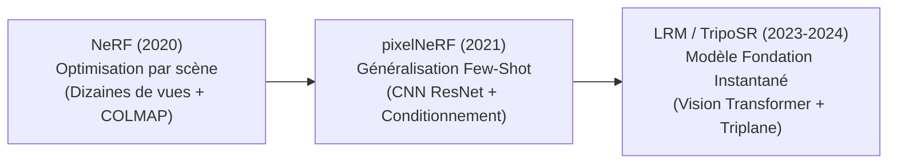

# Tableau de Bord & Suivi d'Avancement du Projet (Master M2I - Vision & 3D)

> **Projet :** De la 2D à la 3D : Étude Comparative et Évolution des Champs de Radiance Neuronaux (NeRF, pixelNeRF & LRM)  
> **Binôme :** 
> - **Toi (Membre 1) :** NeRF classique & pixelNeRF
> - **Samir (Membre 2) :** LRM (Large Reconstruction Model) / TripoSR
> **Date de mise à jour :** 23 Novembre 2026

---

## 1. Vue d'Ensemble & Synthèse Théorique des 3 Modèles

Ce projet retrace le saut de paradigme scientifique majeur de la vision par ordinateur entre 2020 et 2024 :

| Critère | 1. NeRF (Mildenhall 2020) | 2. pixelNeRF (Yu 2021) | 3. LRM / TripoSR (Hong 2023) |
| :--- | :--- | :--- | :--- |
| **Type d'apprentissage** | Optimisation par scène (*Per-scene optimization*) | Entraîné sur dataset multi-scènes (ShapeNet) | Modèle fondation pré-entraîné à grande échelle |
| **Entrées requises** | ~50 à 100 images denses + Poses de caméra ($R, t$) | 1 à 3 images + calibration | **1 seule image non calibrée (*in-the-wild*)** |
| **Temps de reconstruction** | 15 à 45 minutes d'entraînement par scène | Quelques secondes à minutes | **< 1 seconde (Inférence directe)** |
| **Architecture clé** | MLP profond (Positional Encoding) | ResNet-34 (CNN) + MLP conditionné | ViT DINO + Transformer Image-to-Triplane |
| **Représentation 3D** | Champ implicite continu $(\mathbf{x}, \mathbf{d}) \rightarrow (\mathbf{c}, \sigma)$ | Volume implicite aligné aux pixels | Triplane NeRF explicite/implicite + Mesh (.obj/.glb) |

---

## 2. Suivi Détaillé : Toi (Membre 1 - NeRF & pixelNeRF)

### 2.1. Tâche 1 : NeRF Classique (Nerfacto - Entraînement From Scratch)
- **Objectif :** Entraîner le modèle de zéro (*from scratch*) sur la scène Lego pour illustrer le principe d'optimisation continue par scène (Mildenhall 2020).
- **Fichiers associés & Rangements :**
  - **Notebook officiel NeRF :** [`notebooks/01_nerf_lego_30k_complete.ipynb`](file:///c:/Users/DELL/Documents/Master/Master_M2I/SEMESTRE%203/Module%202%20-%20Traitement%20d'images/Projet/notebooks/01_nerf_lego_30k_complete.ipynb)
  - **Checkpoints sauvegardés :** [`models/nerf_checkpoints/lego_30000/`](file:///c:/Users/DELL/Documents/Master/Master_M2I/SEMESTRE%203/Module%202%20-%20Traitement%20d'images/Projet/models/nerf_checkpoints/lego_30000/)
    - Poids finaux : `step-000029999.ckpt` (242 Mo)
    - Fichier de configuration : `config.yml`
    - Tenseurs d'événements Tensorboard : `events.out.tfevents...`
  - **Métriques quantitatives officielles :** [`outputs/benchmark_results/metrics_30000.json`](file:///c:/Users/DELL/Documents/Master/Master_M2I/SEMESTRE%203/Module%202%20-%20Traitement%20d'images/Projet/outputs/benchmark_results/metrics_30000.json)
    - PSNR : **17.76 dB** | SSIM : **0.77** | LPIPS : **0.13**
  - **Vidéos disponibles :** [`results_renders/`](file:///c:/Users/DELL/Documents/Master/Master_M2I/SEMESTRE%203/Module%202%20-%20Traitement%20d'images/Projet/results_renders/)
    - `lego_5000_spiral.mp4` / `lego_5000_spiral_hd.mp4` (Rendus à 5 000 itérations)
    - Note : Le rendu vidéo 30k sera régénéré ultérieurement avec un camera-path adapté. Le checkpoint et les métriques sont déjà parfaitement sécurisés.
- **Statut NeRF :** **Entraînement 30k terminé & métriques validées ✅ (Mis en pause pour la vidéo finale)**.

### 2.2. Tâche 2 : pixelNeRF (Inférence avec Poids Pré-entraînés)
- **Objectif :** Démontrer la généralisation sans ré-optimisation à partir d'une seule image 2D grâce au conditionnement spatial (Yu 2021).
- **Méthode retenue :** Inférence directe avec les poids officiels pré-entraînés sur ShapeNet SRN Chairs (`srn_chair`).
- **Fichiers associés :**
  - **Notebook officiel pixelNeRF :** [`notebooks/02_pixelnerf_inference.ipynb`](file:///c:/Users/DELL/Documents/Master/Master_M2I/SEMESTRE%203/Module%202%20-%20Traitement%20d'images/Projet/notebooks/02_pixelnerf_inference.ipynb)
  - Guide technique complet : [`docs/roadmaps/pixelnerf_guide_et_suivi.md`](file:///c:/Users/DELL/Documents/Master/Master_M2I/SEMESTRE%203/Module%202%20-%20Traitement%20d'images/Projet/docs/roadmaps/pixelnerf_guide_et_suivi.md)
  - **Résultats rapatriés de Google Drive :**
    - Dossier source : [`pixelnerf_results/`](file:///c:/Users/DELL/Documents/Master/Master_M2I/SEMESTRE%203/Module%202%20-%20Traitement%20d'images/Projet/pixelnerf_results/)
    - Vidéo 3D générée : [`results_renders/pixelnerf_chair_1view.mp4`](file:///c:/Users/DELL/Documents/Master/Master_M2I/SEMESTRE%203/Module%202%20-%20Traitement%20d'images/Projet/results_renders/pixelnerf_chair_1view.mp4)
    - Image d'entrée 2D source : [`results_renders/pixelnerf_chair_1view_input.jpg`](file:///c:/Users/DELL/Documents/Master/Master_M2I/SEMESTRE%203/Module%202%20-%20Traitement%20d'images/Projet/results_renders/pixelnerf_chair_1view_input.jpg)
- **Analyse critique de la qualité :**
  - Résolution native SRN : $128 \times 128$ pixels.
  - La reconstruction à 1 vue (`P=64`) montre la forme globale de la chaise et son assise, mais présente des bords flous sur la face arrière (hallucination géométrique normale en l'absence d'information de profondeur).
  - Piste d'amélioration testée : conditionnement multi-vues (`-P '64 104'`).
- **Statut pixelNeRF :** **Inférence Single-View TERMINÉE & validée ✅**

---

## 3. Suivi Détaillé : Samir (Membre 2 - LRM / TripoSR)

### 3.1. Tâche : LRM / TripoSR (Large Reconstruction Model)
- **Objectif :** Démontrer l'état de l'art actuel de la reconstruction monoculaire instantanée par Transformer.
- **Fichiers associés :**
  - Fiche de synthèse théorique : [`articles/article_3_lrm_hong_et_al_2023.md`](file:///c:/Users/DELL/Documents/Master/Master_M2I/SEMESTRE%203/Module%202%20-%20Traitement%20d'images/Projet/articles/article_3_lrm_hong_et_al_2023.md)
  - Papier de recherche : [`articles/Article_LRM.pdf`](file:///c:/Users/DELL/Documents/Master/Master_M2I/SEMESTRE%203/Module%202%20-%20Traitement%20d'images/Projet/articles/Article_LRM.pdf)
  - Feuille de route Samir : [`feuilles_de_route/feuille_de_route_membre_2_lrm.md`](file:///c:/Users/DELL/Documents/Master/Master_M2I/SEMESTRE%203/Module%202%20-%20Traitement%20d'images/Projet/feuilles_de_route/feuille_de_route_membre_2_lrm.md)
  - Code & scripts de Samir : dossier `src/` (branche membre 2)
- **Statut :** **À DÉMARRER ⏳**
- **Étapes clés pour Samir :**
  1. Configurer un notebook Google Colab (GPU T4) avec **TripoSR** (`VAST-AI-Research/TripoSR`) ou **OpenLRM**.
  2. Implémenter le pipeline de prétraitement automatique avec `rembg` (détourage du fond obligatoire).
  3. Effectuer l'inférence sur les **mêmes images de test** que toi pour le benchmark comparatif.
  4. Exporter les vidéos de rendu et les maillages 3D (`.obj` ou `.glb`).
  5. Mesurer le temps d'inférence (généralement < 1 s) et la consommation VRAM.

---

## 4. Protocole de Benchmark Commun (Convergence des Travaux)

Pour comparer équitablement les 3 approches dans le rapport de Master :

| Métrique / Critère | NeRF (Toi) | pixelNeRF (Toi) | LRM / TripoSR (Samir) |
| :--- | :--- | :--- | :--- |
| **Nombre d'images d'entrée** | ~100 vues (Dense) | 1 vue (Monoculaire) | **1 vue (Monoculaire)** |
| **Calibration requise ?** | Oui (COLMAP SfM) | Poses d'entraînement | **Non (In-the-wild)** |
| **Temps de calcul total** | ~15 min (entraînement) | ~3 min (volume rendering) | **~0.6 s (inférence)** |
| **Qualité visuelle** | PSNR: **17.76 dB** / SSIM: **0.77** | Silhouette fidèle, détails $128\times128$ | Haute fidélité (en cours) |
| **Représentation finale** | Densité volumique (NeRF) | Densité volumique (NeRF) | **NeRF Triplane + Mesh 3D (.obj)** |

- **Rapport de projet complet rédigé :** [`reports/RAPPORT_PROJET_2D_TO_3D.md`](file:///c:/Users/DELL/Documents/Master/Master_M2I/SEMESTRE%203/Module%202%20-%20Traitement%20d'images/Projet/reports/RAPPORT_PROJET_2D_TO_3D.md) (Sections NeRF & pixelNeRF rédigées à 100% avec formules mathématiques et métriques réelles).

---

## 5. Journal des Mises à Jour & Historique

- **16-17 Nov 2026 :** Validation de l'environnement Colab GPU T4. Entraînement NeRF (Nerfacto) sur Lego à 5 000 itérations. Export de `lego_5000_spiral.mp4` et `lego_5000_spiral_hd.mp4`.
- **23-24 Nov 2026 :** Création du notebook NeRF 30k complet (`01_nerf_lego_30k_complete.ipynb`), résolution des quotas GPU et correction de sécurité PyTorch (`TORCH_FORCE_NO_WEIGHTS_ONLY_LOAD=1`).
- **25 Nov 2026 :** 
  - Restructuration propre du projet en architecture standard MLOps (`notebooks/`, `docs/`, `repos_reference/`, `results_renders/`).
  - **Validation complète de la phase Membre 1 (NeRF & pixelNeRF)** :
    - NeRF entraîné à 30 000 itérations (checkpoint sauvegardé dans `models/nerf_checkpoints/lego_30000/`, métriques officielles PSNR: 17.76 dB / SSIM: 0.77 enregistrées).
    - pixelNeRF validé en inférence monoculaire 1-vue avec les poids officiels (vidéo `results_renders/pixelnerf_chair_1view.mp4` et image source `results_renders/pixelnerf_chair_1view_input.jpg` sauvegardées).
  - Rédaction intégrale des sections théoriques et expérimentales de NeRF et pixelNeRF dans [`reports/RAPPORT_PROJET_2D_TO_3D.md`](file:///c:/Users/DELL/Documents/Master/Master_M2I/SEMESTRE%203/Module%202%20-%20Traitement%20d'images/Projet/reports/RAPPORT_PROJET_2D_TO_3D.md).

---

## 6. Prochaines Étapes pour la Reprise (Quand Samir termine sa phase)

Dès que Samir livre ses résultats sur LRM / TripoSR, voici la feuille de route exacte pour finaliser le projet :

1. **Rapatrier les livrables de Samir :**
   - La vidéo 3D de rotation 360° générée par LRM (à placer dans `results_renders/`).
   - Le maillage 3D extrait au format `.obj` ou `.glb` (à placer dans `outputs/lrm_renders/`).
   - Le temps d'inférence précis (ex: ~0.6 seconde) et la VRAM consommée.
2. **Tester LRM sur la même chaise que pixelNeRF :**
   - Vérifier que Samir a bien testé l'image source commune [`results_renders/pixelnerf_chair_1view_input.jpg`](file:///c:/Users/DELL/Documents/Master/Master_M2I/SEMESTRE%203/Module%202%20-%20Traitement%20d'images/Projet/results_renders/pixelnerf_chair_1view_input.jpg) pour afficher la comparaison directe dans le rapport.
3. **Compléter le Rapport Final :**
   - Remplir la **Section 4 (LRM)** du document [`reports/RAPPORT_PROJET_2D_TO_3D.md`](file:///c:/Users/DELL/Documents/Master/Master_M2I/SEMESTRE%203/Module%202%20-%20Traitement%20d'images/Projet/reports/RAPPORT_PROJET_2D_TO_3D.md).
   - Compléter la dernière colonne du grand tableau comparatif (Section 5).
4. **Préparer la Présentation / Soutenance :**
   - Créer les diapositives de soutenance avec la vidéo NeRF (multi-vues), la vidéo pixelNeRF (1-vue floue) et le rendu/maillage LRM (1-vue instantanée et nette).
