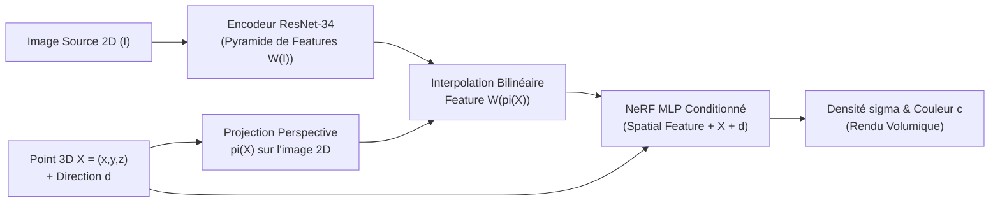

# Guide Technique & Avancement : pixelNeRF (Yu et al., CVPR 2021)

> **Projet Master M2I :** De la 2D à la 3D — Évolution NeRF $\rightarrow$ pixelNeRF $\rightarrow$ LRM  
> **Responsable du Module :** Toi (Membre 1)  
> **Dernière mise à jour :** 25 Novembre 2026

---

## 1. Problématique & Rupture Scientifique

| Problème de NeRF Classique (2020) | Solution apportée par pixelNeRF (2021) |
| :--- | :--- |
| **Strictement sur-appris (overfitting) sur une seule scène** : incapable de comprendre un nouvel objet sans ré-entraînement de zéro. | **Généralisation multi-scènes** : le réseau apprend des *a priori* de forme 3D sur des milliers d'objets (ShapeNet). |
| **Exige 50 à 100 images denses calibrées** + calcul lourd COLMAP. | **Reconstruction à partir d'une seule image 2D (Single-View / Few-View)**. |
| **Entraînement de plusieurs dizaines de minutes par objet**. | **Inférence directe en quelques secondes** (sans aucun entraînement à l'inférence). |

---

## 2. Architecture et Fonctionnement Mathématique

1. **Extraction de Caractéristiques (Feature Extraction) :**  
   L'image 2D d'entrée passe dans un backbone convolutif (**ResNet-34**). On extrait des cartes de caractéristiques multi-échelles $W(I)$.
2. **Alignement Spatial & Projection :**  
   Pour chaque point $X = (x, y, z)$ échantillonné le long d'un rayon de vue, on le projette sur le plan image source via les paramètres de caméra : $\pi(X)$. On extrait la feature correspondante par interpolation bilinéaire : $f_X = W(\pi(X))$.
3. **Conditionnement du MLP :**  
   Le MLP prédit $(\sigma, \mathbf{c})$ en prenant en entrée :
   $$\text{pixelNeRF}(X, \mathbf{d}) = \text{MLP}\big(X, \mathbf{d}, W(\pi(X))\big)$$
4. **Volume Rendering :**  
   L'intégrale de radiance numérique permet de calculer les pixels de la nouvelle vue sans jamais ré-optimiser le réseau.

---

## 3. Stratégie Expérimentale : Inférence vs Ré-entraînement

### Pourquoi l'Inférence avec poids pré-entraînés est la démarche standard ?
- **Dataset complet :** ShapeNet NMR / SRN représente plus de **100 Go de données** et plusieurs centaines de milliers de vues de rendu.
- **Coût d'entraînement from scratch :** Environ 6 jours sur 4 GPU NVIDIA V100 (32 Go). Sur un GPU Colab gratuit (T4, 15 Go), un entraînement complet est inaccessible et dépasserait les quotas.
- **Démarche académique officielle :**  
  1. Utiliser le modèle officiel pré-entraîné par les auteurs (Berkeley) sur **ShapeNet (Chairs & Cars)**.
  2. Valider la généralisation sur des images de test 1-vue jamais vues par le réseau.
  3. Mesurer les métriques (PSNR / SSIM) et générer la vidéo de rotation 360° pour le benchmark face à NeRF et LRM.

---

## 4. Les Jeux de Données (Datasets)

| Dataset | Catégories | Format / Résolution | Rôle |
| :--- | :--- | :--- | :--- |
| **SRN (Scene Representation Networks)** | `chairs` (chaises) / `cars` (voitures) | $128 \times 128$ RGB + matrices caméras | Benchmark standard 1-vue & 2-vues |
| **ShapeNet NMR (DVR format)** | 13 catégories d'objets 3D | $64 \times 64$ RGB | Évaluation multi-catégories et catégories inconnues (*unseen*) |
| **DTU Dataset** | Objets réels multi-vues | $300 \times 400$ | Évaluation de la généralisation sur scènes réelles |

---

## 5. Feuille de Route Opérationnelle (Checklist)

- [x] **Étape 1 :** Compréhension théorique & exploration du code source [`exemple de model existe/pixel-nerf-master`](file:///c:/Users/DELL/Documents/Master/Master_M2I/SEMESTRE%203/Module%202%20-%20Traitement%20d'images/Projet/exemple%20de%20model%20existe/pixel-nerf-master).
- [ ] **Étape 2 :** Création du notebook prêt à l'emploi [`04_pixelnerf_inference.ipynb`](file:///c:/Users/DELL/Documents/Master/Master_M2I/SEMESTRE%203/Module%202%20-%20Traitement%20d'images/Projet/04_pixelnerf_inference.ipynb).
- [ ] **Étape 3 :** Téléchargement des checkpoints pré-entraînés officiels (`srn_chair`, `srn_car`).
- [ ] **Étape 4 :** Inférence sur 1 vue d'entrée ($P=64$) et génération de la vidéo de rotation 360°.
- [ ] **Étape 5 :** Extraction des métriques comparatives et export des résultats pour le rapport final.
