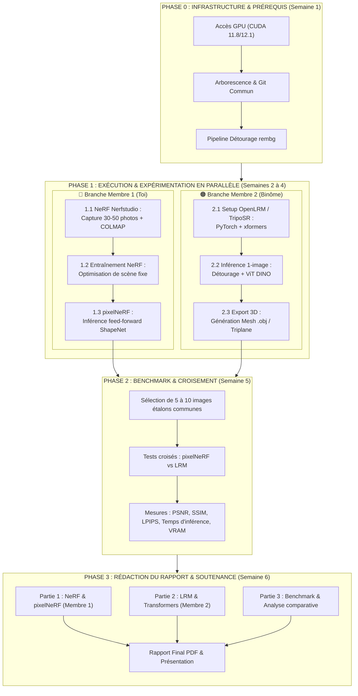

# Suivi de Projet & Cycle de Vie Collaboratif (Lifecycle Dashboard)

> **Projet :** De la 2D à la 3D — Évolution des Champs de Radiance Neuronaux (NeRF $\rightarrow$ pixelNeRF $\rightarrow$ LRM)  
> **Master M2I — Semestre 3 — Module Traitement d'Images & Vision par Ordinateur**  
> **Équipe :** 
> * 🔵 **Membre 1 (Toi) :** NeRF Fondamental & pixelNeRF (CNN Conditionné)
> * 🟠 **Membre 2 (Binôme) :** LRM & TripoSR (Transformers & Fondations 3D)  
> **Dernière mise à jour :** Novembre 2026

---

## 1. Vue d'Ensemble & Légende des Statuts

Ce document sert de **tableau de bord vivant (Living Dashboard)**. À chaque étape franchie par l'un ou l'autre membre, mettez à jour la case correspondante `[ ]` $\rightarrow$ `[x]` et renseignez le statut global.

### Légende d'avancement
* 🔴 **NON DÉMARRÉ** : Phase en attente des prérequis
* 🟡 **EN COURS** : Expérimentations et implémentations en cours
* 🟢 **TERMINÉ / VALIDÉ** : Livrable généré, testé et validé par le binôme
* ⚠️ **BLOQUÉ** : Problème technique (ex: incompatibilité CUDA, manque de VRAM GPU)

| Composant | Responsable | Statut Global | Prochaine Étape Clé |
| :--- | :---: | :---: | :--- |
| **Phase 0 : Infrastructure Commune** | 🔵 + 🟠 | 🟡 EN COURS | Configuration GPU & Environnements Conda |
| **Phase 1.A : NeRF Classique** | 🔵 Membre 1 | 🔴 NON DÉMARRÉ | Capture de scène + `ns-train nerfacto` |
| **Phase 1.B : pixelNeRF** | 🔵 Membre 1 | 🔴 NON DÉMARRÉ | Inférence ShapeNet avec checkpoint officiel |
| **Phase 1.C : LRM / TripoSR** | 🟠 Membre 2 | 🔴 NON DÉMARRÉ | Inférence rapide avec détourage `rembg` |
| **Phase 2 : Benchmark Commun** | 🔵 + 🟠 | 🔴 NON DÉMARRÉ | Test croisé sur 5 images étalons |
| **Phase 3 : Rédaction & Rapport** | 🔵 + 🟠 | 🔴 NON DÉMARRÉ | Synthèse comparative & figures |

---

## 2. Diagramme du Cycle de Vie (Gantt & Dépendances)



---

## 3. Détail des Phases et Checklists Opérationnelles

### Phase 0 : Infrastructure & Prérequis Communs
*Objectif : Valider les socles matériels et logiciels pour éliminer les blocages d'environnement.*

#### 🛠️ Ce dont vous avez besoin :
* Un GPU NVIDIA avec au minimum 8 Go de VRAM (idéalement 12+ Go) ou Google Colab Pro / Kaggle.
* Dépôt structuré avec les sous-dossiers préparés.
* Script de détourage automatique (`rembg`) pour isoler l'objet du fond.

#### 📋 Checklist d'avancement :
- [ ] **Accès GPU validé** : Vérifier la disponibilité de CUDA via `python -c "import torch; print(torch.cuda.is_available(), torch.cuda.get_device_name(0))"`.
- [ ] **Arborescence du projet créée** : Créer les dossiers `data/`, `src/`, `models/`, `outputs/`, `reports/`.
- [ ] **Outil de détourage installé** : Valider l'exécution de `rembg` sur une photo de test.
- [ ] **Dépôt Git initialisé** : Cloner le dépôt et définir la règle de branches (`main`, `dev-membre1`, `dev-membre2`).

---

### Phase 1 : Exécution & Expérimentation en Parallèle

---

#### 🔵 Branche Membre 1 (Toi) : NeRF & pixelNeRF

##### Étape 1.1 : Le Socle Fondamental — NeRF Classique avec Nerfstudio
* **Objectif :** Comprendre le rendu volumique continu et l'optimisation par scène via descente de gradient.
* **Actions concrètes :**
  1. Installer `nerfstudio` (`pip install nerfstudio`).
  2. Capturer une courte vidéo (30 à 45s) autour d'un objet statique bien texturé, ou télécharger le dataset officiel *Lego*.
  3. Lancer l'extraction de poses avec COLMAP via Nerfstudio :
     ```bash
     ns-process-data video --data data/raw/mon_objet.mp4 --output-dir data/processed/colmap_scenes/mon_objet
     ```
  4. Lancer l'entraînement avec le modèle rapide `nerfacto` :
     ```bash
     ns-train nerfacto --data data/processed/colmap_scenes/mon_objet
     ```
  5. Visualiser en temps réel dans le viewer web local (observer la convergence du champ de radiance).
* **Livrables attendus :**
  - [ ] Poids entraînés du modèle NeRF sauvegardés dans `models/nerf_checkpoints/`.
  - [ ] Rendu vidéo fluide (360°) exporté dans `outputs/nerf_renders/`.
  - [ ] Temps total d'entraînement et mémoire VRAM notés pour le benchmark.

##### Étape 1.2 : Le Saut vers la Généralisation — pixelNeRF
* **Objectif :** Reconstruire un objet 3D à partir d'une seule image en utilisant un encodeur convolutif (ResNet) pré-entraîné.
* **Actions concrètes :**
  1. Cloner le dépôt officiel : `git clone https://github.com/sxyu/pixel-nerf.git src/member1_nerf_pixelnerf/pixel-nerf`.
  2. Télécharger les checkpoints pré-entraînés ShapeNet (ex: catégorie *Chairs* ou *Cars*).
  3. Préparer une image de test détourée (fond transparent ou blanc pur).
  4. Lancer le script d'évaluation monoculaire :
     ```bash
     python eval/eval.py --conf exp/conf/chairs.conf --resume models/pixelnerf_checkpoints/chairs.ckpt --data ...
     ```
* **Livrables attendus :**
  - [ ] Inférence monoculaire fonctionnelle sur une image 2D isolée.
  - [ ] Vues synthétisées sous plusieurs angles sans aucun réentraînement par scène.
  - [ ] Fichiers de rendu enregistrés dans `outputs/pixelnerf_renders/`.

---

#### 🟠 Branche Membre 2 (Ton Binôme) : LRM (Large Reconstruction Model)

##### Étape 2.1 : Configuration du Modèle Fondation 3D
* **Objectif :** Déployer une architecture moderne de type Transformer (Vision Transformer DINO + Triplane NeRF).
* **Actions concrètes :**
  1. Cloner l'implémentation de référence : **OpenLRM** (`3DTopia/OpenLRM`) ou l'alternative optimisée **TripoSR** (`VAST-AI-Research/TripoSR`).
  2. Configurer les dépendances : PyTorch, `xformers` (accélération attention), `transformers`, `trimesh`.
  3. Télécharger les poids pré-entraînés à grande échelle (issus d'Objaverse) via Hugging Face.
* **Livrables attendus :**
  - [ ] Environnement opérationnel avec modèle chargé sur GPU.
  - [ ] Script de test validant le chargement des poids du Transformer.

##### Étape 2.2 : Inférence 2D vers 3D Instantanée & Export de Maillage
* **Objectif :** Convertir une photo arbitraire *in-the-wild* en modèle 3D complet en moins de 2 secondes.
* **Actions concrètes :**
  1. Créer un script de pré-traitement qui prend une image, supprime l'arrière-plan via `rembg`, recentre le sujet avec marge et redimensionne en $512 \times 512$.
  2. Exécuter l'inférence LRM :
     ```bash
     python run_lrm.py --image data/processed/masked_single_images/objet_test.png --output-dir outputs/lrm_renders/
     ```
  3. Extraire le maillage 3D surfacique via Marching Cubes sur le Triplane.
* **Livrables attendus :**
  - [ ] Fichier maillage 3D (`.obj` ou `.glb`) généré avec texture.
  - [ ] Vidéo de rendu orbital 360° générée.
  - [ ] Mesure du temps d'inférence exact (généralement $< 1$ seconde).

---

### Phase 2 : Benchmarking, Comparaison & Intégration (Travail Commun)
*Objectif : Mettre en concurrence scientifique directe les deux approches monoculaires (pixelNeRF vs LRM).*

#### 🛠️ Protocole d'évaluation :
* Définir un **jeu de test étalon commun de 5 images** :
  1. *Test 1 :* Objet standard de catégorie connue (ex: une chaise design).
  2. *Test 2 :* Véhicule ou moyen de transport (ex: voiture).
  3. *Test 3 :* Objet complexe avec textures variées (ex: peluche ou chaussure).
  4. *Test 4 :* Objet avec occlusions ou géométrie asymétrique.
  5. *Test 5 :* Cas limite (*edge case*) : angle de vue rasant ou éclairage difficile.

#### 📋 Grille comparative à remplir :

| Critère d'Évaluation | NeRF Original (Membre 1) | pixelNeRF (Membre 1) | LRM / TripoSR (Membre 2) |
| :--- | :---: | :---: | :---: |
| **Entrées requises** | 30-50 photos multi-vues | 1 photo | 1 photo |
| **Besoin de poses caméras (COLMAP)** | Oui (Indispensable) | Oui (À l'inférence) | **Non (Prior géométrique appris)** |
| **Temps d'adaptation par objet** | ~10 à 30 minutes | **0 s (Feed-forward)** | **0 s (Feed-forward)** |
| **Temps d'inférence d'une vue** | ~0.5 - 2 s (Ray-marching) | ~0.2 - 1 s | **< 0.5 s (Triplane + MLP)** |
| **Format du rendu de sortie** | Champ continu (Rendu 2D) | Champ continu (Rendu 2D) | **Maillage 3D explicite (.obj) + Rendu** |
| **Qualité des faces non vues** | N/A (Scène complète scannée) | Faible (estimation floue) | **Élevée (prior Transformer appris)** |
| **PSNR moyen (sur images test)** | `[À mesurer]` | `[À mesurer]` | `[À mesurer]` |
| **SSIM moyen (sur images test)** | `[À mesurer]` | `[À mesurer]` | `[À mesurer]` |
| **LPIPS moyen (distance perceptuelle)**| `[À mesurer]` | `[À mesurer]` | `[À mesurer]` |

---

### Phase 3 : Restitution, Rédaction & Préparation de Soutenance
*Objectif : Transformer les expérimentations techniques en un rapport de Master rigoureux et impactant.*

#### 📋 Répartition de la Rédaction :

```text
RAPPORT FINAL
│
├── Introduction & Contexte (En commun)
│   ├── Problème inverse de la reconstruction 3D monoculaire
│   └── Des représentations explicites (voxels/maillages) aux représentations implicites
│
├── Chapitre 1 : Le Socle Fondamental — NeRF (Rédigé par Membre 1)
│   ├── Formulation mathématique : Lancer de rayons, Density σ et Couleur RGB
│   ├── Encodage positionnel et rendu volumique continu
│   └── Analyse expérimentale avec Nerfstudio (temps d'optimisation vs qualité visuelle)
│
├── Chapitre 2 : Vers la Généralisation Monoculaire — pixelNeRF (Rédigé par Membre 1)
│   ├── Conditionnement spatial par encodeur CNN (ResNet)
│   ├── Projection alignée sur les rayons
│   └── Forces et limites observées sur les jeux de données (ShapeNet vs photos réelles)
│
├── Chapitre 3 : L'État de l'Art à Grande Échelle — LRM (Rédigé par Membre 2)
│   ├── Le paradigme des Transformers appliqué à la 3D
│   ├── Encodeur ViT (DINO) et représentation Triplane
│   └── Génération instantanée et extraction de maillages
│
├── Chapitre 4 : Étude Comparative & Benchmark Expérimental (En commun)
│   ├── Présentation du protocole de test et métriques (PSNR, SSIM, LPIPS)
│   ├── Analyse critique du tableau de bord comparatif
│   ├── Comparaison visuelle côte à côte des rendus
│   └── Cas d'échec et analyse de robustesse
│
└── Conclusion & Perspectives (En commun)
    ├── Bilan des 3 approches
    └── Ouverture vers le 3D Gaussian Splatting (3DGS) pour le rendu temps réel
```

---

## 4. Guide des Commandes Utiles & Synchronisation

### Synchronisation Git entre binômes
```bash
# Récupérer les dernières modifications de l'autre membre
git pull origin main

# Travailler sur sa branche dédiée
git checkout -b feature-membre1-pixelnerf
# ou pour le binôme :
git checkout -b feature-membre2-lrm

# Sauvegarder son avancée
git add .
git commit -m "feat(membre1): inference pixelnerf validee sur image chaise"
git push origin feature-membre1-pixelnerf
```

### Script de calcul des métriques communes (`src/common/metrics.py`)
```bash
# Exemple d'appel pour comparer les dossiers de sorties
python src/common/metrics.py \
  --gt_dir data/benchmark_samples/ground_truth/ \
  --pred_dir outputs/pixelnerf_renders/ \
  --output_csv outputs/benchmark_results/pixelnerf_metrics.csv
```
