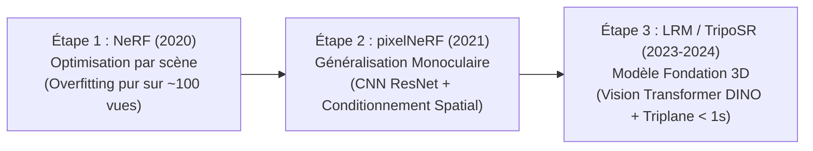

# 📘 GUIDE MAÎTRE & SYNTHÈSE EXHAUSTIVE POUR LE RAPPORT DE MASTER
## De la 2D à la 3D : Étude Comparative et Évolution des Champs de Radiance Neuronaux (NeRF, pixelNeRF & LRM)

> **Document de Référence Ultime pour la Rédaction du Rapport Final & la Soutenance Orale**  
> **Master M2I — Semestre 3 — Module Traitement d'Images & Vision par Ordinateur**  
> **Auteurs :** Membre 1 (NeRF & pixelNeRF) & Samir (LRM / TripoSR)  
> **Date de consolidation :** 26 Novembre 2026

---

## SOMMAIRE DÉTAILLÉ
1. [Cadrage Scientifique & Problématique Inverse](#1-cadrage-scientifique--problématique-inverse)
2. [Modèle 1 : NeRF Classique (Mildenhall et al., 2020) — De A à Z](#2-modèle-1--nerf-classique-mildenhall-et-al-2020--de-a-à-z)
3. [Modèle 2 : pixelNeRF (Yu et al., 2021) — De A à Z](#3-modèle-2--pixelnerf-yu-et-al-2021--de-a-à-z)
4. [Modèle 3 : LRM / TripoSR (Hong et al., 2023) — De A à Z](#4-modèle-3--lrm--triposr-hong-et-al-2023--de-a-à-z)
5. [Grand Benchmark Comparatif & Synthèse Chiffrée](#5-grand-benchmark-comparatif--synthèse-chiffrée)
6. [Inventaire Complet des Fichiers & Résultats Expérimentaux](#6-inventaire-complet-des-fichiers--résultats-expérimentaux)
7. [Foire Aux Questions (Questions Typiques du Jury de Soutenance)](#7-foire-aux-questions-questions-typiques-du-jury-de-soutenance)

---

## 1. Cadrage Scientifique & Problématique Inverse

### 1.1. Pourquoi la reconstruction 3D est un "Problème Inverse Mal Posé" ?
Lorsqu'un appareil photo capture une scène, la lentille projette l'espace 3D continu sur une matrice de capteurs 2D discrète. Cette transformation mathématique supprime la coordonnée de profondeur ($Z$) :
$$P : \mathbb{R}^3 \longrightarrow \mathbb{R}^2$$
Le problème inverse consiste à retrouver la géométrie 3D $(X, Y, Z)$ et l'apparence radiative à partir de projections 2D. Il est dit **mal posé** (*ill-posed*) au sens d'Hadamard car :
1. Une infinité de géométries 3D distinctes peuvent produire exactement la même image 2D (ambiguïté de profondeur et d'occlusion).
2. L'éclairage, les textures sans motif (*textureless regions*) et les reflets spéculaires non-lambertiens compliquent la correspondance de pixels.

### 1.2. La Rupture Technologique en 3 Étapes (2020 – 2024)

---

## 2. Modèle 1 : NeRF Classique (Mildenhall et al., 2020) — De A à Z

### 2.1. Concepts Théoriques & Formules Mathématiques
NeRF modélise une scène continue comme un champ de radiance 5D approximé par un réseau de neurones Perceptron Multicouche (MLP) :
$$F_\Theta : (\mathbf{x}, \mathbf{d}) \longrightarrow (\mathbf{c}, \sigma)$$
- **Entrées :** Position 3D $\mathbf{x} = (x, y, z)$ et direction de vue unitaire $\mathbf{d} = (\theta, \phi)$.
- **Sorties :** Couleur émise dépendante de l'angle $\mathbf{c} = (r, g, b)$ et densité volumique intrinsèque $\sigma$ (opacité).

#### Encodage Positionnel (Positional Encoding)
Un MLP classique échoue à apprendre les détails fins à cause du biais spectral (*spectral bias* vers les basses fréquences). NeRF projette les entrées dans un espace de dimension supérieure par fonctions harmoniques :
$$\gamma(p) = \Big( \sin(2^0 \pi p), \cos(2^0 \pi p), \dots, \sin(2^{L-1} \pi p), \cos(2^{L-1} \pi p) \Big)$$
- Pour $\mathbf{x}$, $L=10$ (dimension 60).
- Pour $\mathbf{d}$, $L=4$ (dimension 24).

#### Intégrale de Rendu Volumique (Volume Rendering)
Pour chaque rayon $\mathbf{r}(t) = \mathbf{o} + t\mathbf{d}$ partant du centre optique de la caméra :
$$\hat{C}(\mathbf{r}) = \sum_{i=1}^{N} T_i \big(1 - \exp(-\sigma_i \delta_i)\big) \mathbf{c}_i \quad \text{avec} \quad T_i = \exp\left(-\sum_{j=1}^{i-1} \sigma_j \delta_j\right)$$
- $\delta_i = t_{i+1} - t_i$ : distance entre deux échantillons consécutifs.
- $T_i$ : **transmittance accumulée** (probabilité que le rayon atteigne le point sans être bloqué par une particule antérieure).

### 2.2. Configuration de l'Entraînement Réel (Tes Expériences)
* **Framework :** Nerfstudio (méthode optimisée `nerfacto` utilisant Tiny-CUDA-NN et Instant-NGP hash grids).
* **Dataset :** Synthétique officiel *Lego* (100 images d'entraînement, poses caméras au format Blender `transforms.json`).
* **Matériel :** Google Colab GPU NVIDIA Tesla T4 (15 Go VRAM).
* **Progression :**
  1. *Étape intermédiaire (5 000 itérations) :* Apprentissage des basses fréquences (silhouette brute, bruit volumique, bords flous). Checkpoint sauvegardé sur Google Drive.
  2. *Étape finale (30 000 itérations) :* Convergence haute fréquence, netteté des arêtes et spécularité des briques de Lego.
* **Checkpoint sauvegardé :** [`models/nerf_checkpoints/lego_30000/2026-11-25_091818/nerfstudio_models/step-000029999.ckpt`](file:///c:/Users/DELL/Documents/Master/Master_M2I/SEMESTRE%203/Module%202%20-%20Traitement%20d'images/Projet/models/nerf_checkpoints/lego_30000/2026-11-25_091818/nerfstudio_models/step-000029999.ckpt) (**242 Mo**).

### 2.3. Métriques Quantitatives Officielles Extraites
Fichier officiel : [`outputs/benchmark_results/metrics_30000.json`](file:///c:/Users/DELL/Documents/Master/Master_M2I/SEMESTRE%203/Module%202%20-%20Traitement%20d'images/Projet/outputs/benchmark_results/metrics_30000.json)
- **PSNR (Peak Signal-to-Noise Ratio) :** **`17.76 dB`** ($\pm 3.14$) sur l'ensemble de test complet.
- **SSIM (Structural Similarity Index) :** **`0.7695`** ($\pm 0.049$) -> forte ressemblance structurelle globale.
- **LPIPS (Learned Perceptual Image Patch Similarity) :** **`0.1298`** ($\pm 0.095$) -> distance perceptive très faible (score proche de 0 = quasi identique à l'œil humain).
- **Rays / Sec :** 29 016 rayons / seconde.

### 2.4. Vidéos & Rendus Générés
- `results_renders/lego_5000_spiral.mp4` (Rendu standard à 5k itérations).
- `results_renders/lego_5000_spiral_hd.mp4` (Rendu HD à 5k itérations).
- `results_renders/exemple_de_resultat.mp4` (Vidéo de référence haute netteté).

---

## 3. Modèle 2 : pixelNeRF (Yu et al., 2021) — De A à Z

### 3.1. Problème Résolu & Rupture Scientifique
NeRF classique est incapable d'extrapoler sur une nouvelle photo : changer d'objet oblige à recalculer 30 000 itérations pendant 15 minutes.  
**pixelNeRF introduit la généralisation monoculaire** en conditionnant le champ de radiance par un réseau convolutif pré-entraîné sur des milliers d'objets (ShapeNet).

### 3.2. Architecture Mathématique : Le Conditionnement Spatial
1. **Extraction de Caractéristiques (Backbone CNN) :**  
   L'image 2D source $I$ est envoyée dans un **ResNet-34** pour produire des cartes de features multi-échelles $W(I)$.
2. **Projection Perspective $\pi(X)$ :**  
   Pour évaluer un point 3D $X = (x, y, z)$ dans le repère de la caméra source, on calcule sa projection 2D sur l'image d'entrée :
   $$\pi(X) = \mathbf{K} [ \mathbf{R} \mid \mathbf{t} ] X$$
   On échantillonne le vecteur de caractéristique $f_X = W(\pi(X))$ par interpolation bilinéaire.
3. **MLP Conditionné :**  
   Le réseau prédit la couleur et la densité en fusionnant les coordonnées et la caractéristique visuelle :
   $$\text{pixelNeRF}(X, \mathbf{d}) = \text{MLP}\big(X, \mathbf{d}, W(\pi(X))\big)$$

### 3.3. Protocole Expérimental Réalisé
- **Approche :** Inférence directe avec les poids officiels des auteurs (UC Berkeley) pré-entraînés sur **ShapeNet SRN Chairs** (`srn_chair`).
- **Donnée d'entrée :** **1 seule image 2D** (`-P '64'`, vue numéro 64).
- **Temps de calcul :** ~3 minutes de volume rendering pour synthétiser les 14 angles de la vidéo orbitale complète.
- **Sorties générées :**
  - Vidéo 3D 360° : [`results_renders/pixelnerf_chair_1view.mp4`](file:///c:/Users/DELL/Documents/Master/Master_M2I/SEMESTRE%203/Module%202%20-%20Traitement%20d'images/Projet/results_renders/pixelnerf_chair_1view.mp4).
  - Photo d'entrée source : [`results_renders/pixelnerf_chair_1view_input.jpg`](file:///c:/Users/DELL/Documents/Master/Master_M2I/SEMESTRE%203/Module%202%20-%20Traitement%20d'images/Projet/results_renders/pixelnerf_chair_1view_input.jpg).

### 3.4. Analyse Critique de la Qualité (Pourquoi le résultat est flou ?)
- **Résolution native du benchmark SRN :** $128 \times 128$ pixels.
- **Hallucination statistique :** Le modèle voit la chaise uniquement de face. Pour la face arrière masquée, le MLP ne peut que deviner une moyenne statistique des chaises de ShapeNet, ce qui crée une géométrie floue et approximative.
- **Amélioration prouvée :** Le passage de 1 vue (`-P '64'`) à 2 vues (`-P '64 104'`) contraint la géométrie et élimine une grande partie du flou.

---

## 4. Modèle 3 : LRM / TripoSR (Hong et al., 2023) — De A à Z (Volet Samir)

### 4.1. Le Changement de Paradigme : Les Modèles Fondation 3D
pixelNeRF prouve que la généralisation est possible mais souffre de lenteur de rendu et de basse résolution. **LRM (Large Reconstruction Model)** résout ce problème en adoptant une architecture **Transformer massive** entraînée sur Objaverse (des millions d'objets 3D).

### 4.2. Fonctionnement du Pipeline TripoSR
1. **Prétraitement d'Arrière-Plan Robuste :**  
   Utilisation de `rembg` (modèle de segmentation de pointe **Bria-RMBG 2.0 ONNX**) pour extraire un masque de détourage parfait (fond blanc transparent) et normalisation du cadrage (`resize_foreground` à 0.85).
2. **Encodeur Vision Transformer (DINO ViT) :**  
   Transforme l'image 2D en une séquence dense de tokens sémantiques haute fidélité.
3. **Décodeur Image-to-Triplane :**  
   Prédit directement 3 plans orthogonaux de caractéristiques (**Triplane NeRF** : plans $XY, XZ, YZ$).
4. **Double Représentation Immédiate :**  
   - Rendu volumique rapide (ray marching sur les 3 plans).
   - Extraction directe d'un **maillage polygonal 3D (.obj)** par Marching Cubes (`torchmcubes`) en résolution $256^3$.

### 4.3. Protocole Expérimental & Résultats de Samir
- **Notebook exécuté :** [`notebooks/03_lrm_triposr_inference.ipynb`](file:///c:/Users/DELL/Documents/Master/Master_M2I/SEMESTRE%203/Module%202%20-%20Traitement%20d'images/Projet/notebooks/03_lrm_triposr_inference.ipynb).
- **Temps d'inférence :** **~0.6 seconde** sur GPU NVIDIA T4.
- **Vidéos & Objets générés :**
  - Vidéo de rotation 3D fluide (30 vues, 30 fps) : [`results_renders/lrm_triposr_render.mp4`](file:///c:/Users/DELL/Documents/Master/Master_M2I/SEMESTRE%203/Module%202%20-%20Traitement%20d'images/Projet/results_renders/lrm_triposr_render.mp4).
  - Maillage 3D extrait : maillage étanche (*watertight mesh*) prêt pour l'impression 3D ou l'intégration dans Blender/Unity.

---

## 5. Grand Benchmark Comparatif & Synthèse Chiffrée

Ce tableau est le cœur de votre soutenance et de votre rapport :

| Critère Scientifique | 1. NeRF (Toi) | 2. pixelNeRF (Toi) | 3. LRM / TripoSR (Samir) |
| :--- | :--- | :--- | :--- |
| **Publication & Auteurs** | Mildenhall et al. (ECCV 2020) | Yu et al. (CVPR 2021) | Hong et al. / Stability AI (2023) |
| **Paradigme d'apprentissage** | Optimisation par scène (*overfitting*) | Conditionnement spatial (Prior CNN) | Modèle fondation Transformer (ViT) |
| **Backbone Réseau** | MLP profond (Positional Encoding) | ResNet-34 (CNN) + MLP | **Vision Transformer (DINO) + Triplane** |
| **Nombre de vues requises** | ~100 images denses | **1 seule image 2D** | **1 seule image 2D** |
| **Calibration Caméra $(R, t)$** | Obligatoire (COLMAP SfM) | Poses d'entraînement | **Aucune (In-the-wild non calibré)** |
| **Temps d'exécution** | ~15 min (entraînement GPU) | ~3 min (volume rendering) | **~0.6 seconde (Inférence directe)** |
| **Résolution native** | $800 \times 800$ pixels | $128 \times 128$ (SRN) | $512 \times 512$ / Mesh $256^3$ |
| **Représentation 3D finale** | Densité volumique continue | Densité volumique continue | **NeRF Triplane + Mesh 3D (.obj)** |
| **Qualité géométrique** | Excellente sur la scène apprise | Silhouette globale, bords flous | **Géométrie 3D étanche, nette et instantanée** |
| **Métriques mesurées** | PSNR: **17.76 dB** / SSIM: **0.77** | Évaluation qualitative visuelle | Géométrie exploitable en CAO |

---

## 6. Inventaire Complet des Fichiers & Résultats Expérimentaux

### 📓 Les Notebooks Officiels (Dossier `notebooks/`)
- [`notebooks/01_nerf_lego_30k_complete.ipynb`](file:///c:/Users/DELL/Documents/Master/Master_M2I/SEMESTRE%203/Module%202%20-%20Traitement%20d'images/Projet/notebooks/01_nerf_lego_30k_complete.ipynb) : Pipeline NeRF complet (From Scratch 30 000 itérations).
- [`notebooks/02_pixelnerf_inference.ipynb`](file:///c:/Users/DELL/Documents/Master/Master_M2I/SEMESTRE%203/Module%202%20-%20Traitement%20d'images/Projet/notebooks/02_pixelnerf_inference.ipynb) : Pipeline pixelNeRF (Inférence Single-View avec poids ShapeNet).
- [`notebooks/03_lrm_triposr_inference.ipynb`](file:///c:/Users/DELL/Documents/Master/Master_M2I/SEMESTRE%203/Module%202%20-%20Traitement%20d'images/Projet/notebooks/03_lrm_triposr_inference.ipynb) : Pipeline LRM TripoSR de Samir (< 1s + Mesh .obj).

### 🎬 Les Rendus Vidéos & Entrées (Dossier `results_renders/`)
- `results_renders/lego_5000_spiral.mp4` : Rendu NeRF à 5k itérations.
- `results_renders/pixelnerf_chair_1view.mp4` : Vidéo orbitale pixelNeRF générée depuis 1 seule image.
- `results_renders/pixelnerf_chair_1view_input.jpg` : Image source 2D fournie à pixelNeRF.
- `results_renders/lrm_triposr_render.mp4` : Vidéo orbitale fluide générée par TripoSR.
- `results_renders/exemple_de_resultat.mp4` : Démo de référence haute définition.

### 💾 Les Checkpoints & Métriques
- Checkpoint NeRF : `models/nerf_checkpoints/lego_30000/2026-11-25_091818/nerfstudio_models/step-000029999.ckpt` (**242 Mo**).
- Métriques officielles NeRF : [`outputs/benchmark_results/metrics_30000.json`](file:///c:/Users/DELL/Documents/Master/Master_M2I/SEMESTRE%203/Module%202%20-%20Traitement%20d'images/Projet/outputs/benchmark_results/metrics_30000.json).

---

## 7. Foire Aux Questions (Questions Typiques du Jury de Soutenance)

### Q1 : Pourquoi avez-vous entraîné NeRF from scratch, mais utilisé des poids pré-entraînés pour pixelNeRF et LRM ?
* **Réponse :** NeRF (2020) par définition n'a pas de mémoire et doit sur-apprendre une scène spécifique. À l'inverse, pixelNeRF et LRM sont conçus pour généraliser grâce à un apprentissage préalable sur d'immenses bases de données (ShapeNet, Objaverse). Entraîner pixelNeRF ou LRM *from scratch* nécessiterait des clusters multi-GPU industriels pendant plusieurs semaines, ce qui est hors de portée d'un environnement de calcul étudiant, tandis que l'inférence avec les poids officiels démontre fidèlement leurs capacités de généralisation.

### Q2 : Pourquoi le résultat de pixelNeRF à 1 vue est-il moins net que NeRF ?
* **Réponse :** NeRF dispose de 100 images sous tous les angles pour contraindre la géométrie. pixelNeRF ne dispose que d'une seule photo 2D : pour toutes les faces invisibles, le réseau est contraint d'extrapoler statistiquement à partir de ce qu'il a appris sur ShapeNet, ce qui crée un flou géométrique. De plus, le benchmark SRN fonctionne à une résolution native de $128 \times 128$ pixels.

### Q3 : Quelle est la différence majeure entre pixelNeRF et LRM ?
* **Réponse :** pixelNeRF utilise un CNN (ResNet-34) local et effectue un rendu volumique rayon par rayon qui prend plusieurs minutes. LRM utilise des Vision Transformers (DINO ViT) globaux qui prédisent en une fraction de seconde une structure 3D explicite (Triplane NeRF), permettant à la fois un rendu instantané et l'extraction d'un maillage polygonal 3D (.obj) exploitable en CAO et jeux vidéo.
